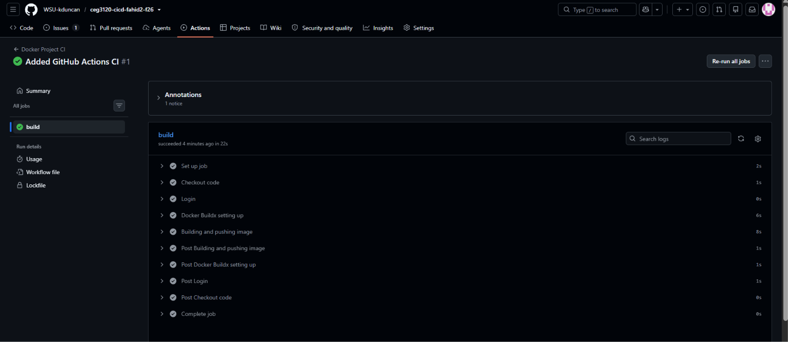
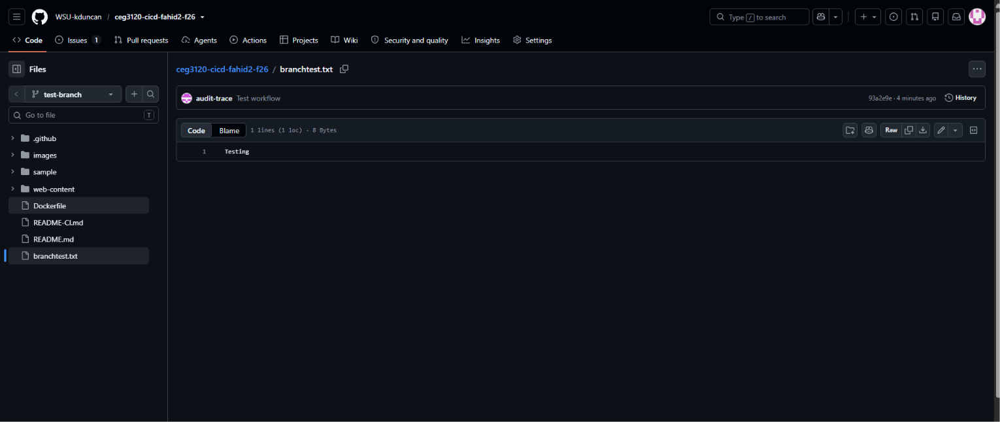
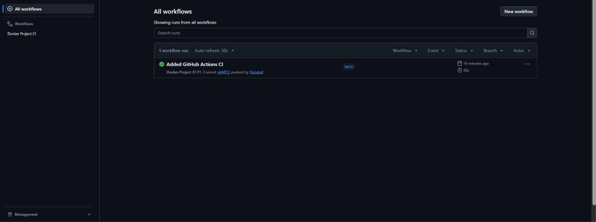
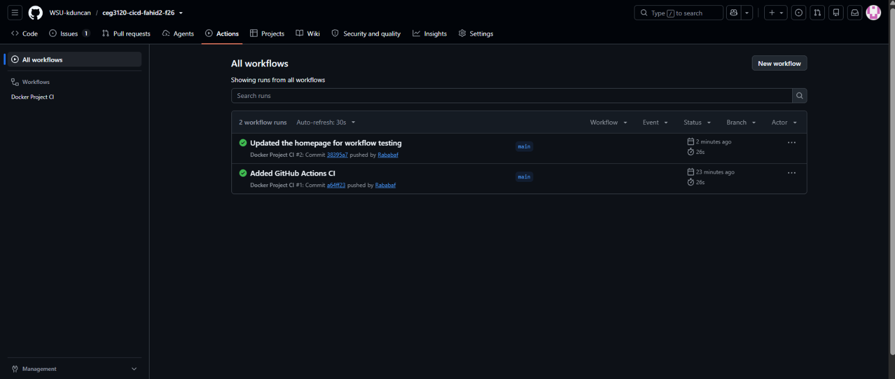
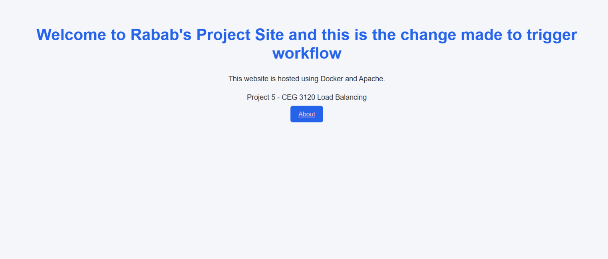
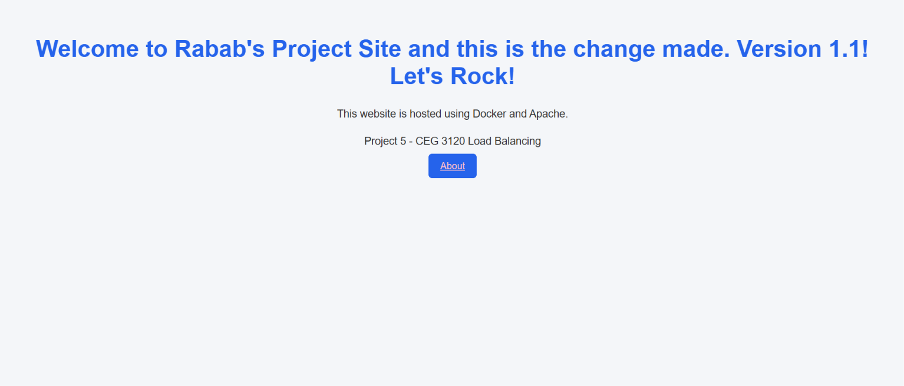
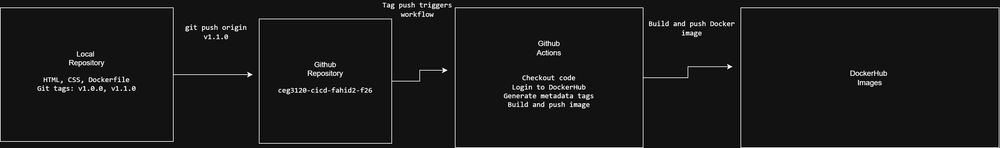

# Project 6 - CI

## Part 1 - Docker Container Image

### Website Content

For this project, I reused the website files that I created during Project 5. The website contains the two HTML pages, index.html and about.html, along with style.css


### Docker

I created a Dockerfile using these:

```dockerfile
FROM httpd:2.4
COPY web-content/ /usr/local/apache2/htdocs/
```

I built the image using:

```bash
docker build -t rababaf/cicd:1.0 .
```

I ran the image using:

```bash
docker run -d --name fahid-webserver -p 8090:80 rababaf/cicd:1.0
```

### DockerHub

I created a public DockerHub repository and logged in using a Personal Access Token with read and write permissions and a 90 day expiration.

I pushed the image using:

```bash
docker push rababaf/cicd:1.0
```

DockerHub repository: 

```https://hub.docker.com/r/rababaf/cicd```

### Testing

I tested the running container using:

```bash
docker ps
```
Accessing the web pages:

- http://localhost:8090/
- http://localhost:8090/about.html


## Part 2 - GitHub Actions

### Secrets

Two secrets were created in my Git repository. The process was done by going to Settings > Secrets and Variables. Also, the token which I generated is not pushed into my github repository according to the project guidelines due to security reasons. However, the token was utilized in the github Actions so the workflow logs in to Dockerhub and automates the workflow accordingly.

- `DOCKER_USERNAME` contains my DockerHub username.
- `DOCKER_TOKEN` contains my DockerHub PAT


### GitHub Actions Workflow

I created a workflow file named `docker-ci.yml` inside `.github/workflows/`. One issue I faced while pushing the `.github/workflows/`  was it was not authorized to be pushed. Therefore, I changed my permissions on github that included workflow as well. 
The workflow runs when I push a commit to the `main` branch.

The workflow contains four stages:

1. Checkout code - Gets the repository files.
2. Login - Logs in to DockerHub using GitHub Secrets in Actions.
3. Docker Buildx setup - Sets up Docker for creating the image.
4. Build and push - Builds the image using my Dockerfile and pushes it to DockerHub as `rababaf/cicd:latest`.


### Testing GitHub Actions

According to the instructions, I intially tested my workflow by pushing the file to the main branch and the workflow ran without issues. 


### Testing Test branch 

Moving forward I  created a separate branch called `test-branch` and committed a file named `branchtest.txt`.

I pushed this branch to GitHub to verify that the workflow would not run.The following screenshot shows my test commit on the separate branch and eventually it did not trigger any workflow action on my main branch.





### Testing Website Changes

GitHub Actions automatically ran and built and pushed the updated Docker image to DockerHub for the changes I made to my `index.html` file.



I pulled the updated Docker image using:

```bash
docker pull rababaf/cicd:latest
```

Then I ran the updated image using:

```bash
docker run -d --name fahid-updated -p 8091:80 rababaf/cicd:latest
```

I opened `http://localhost:8091/` in my browser and confirmed that the updated homepage text appeared with the updated CSS.



DockerHub repository: [rababaf/cicd](https://hub.docker.com/r/rababaf/cicd)


## Part 3 - Semantic Versioning

### Creating Git Tags

According to project guidelines,for Part 3, I used Git tags to create two different versions of my site.

To see tags: 

```bash

git tag -l```

Frst version tag:

```bash
git tag -a v1.0.0 ```

To push the tag:

```bash
git push origin v1.0.0
```

### Semantic Versioning with GitHub Actions

The following was changed in the yaml file:

```yaml
on:
  push:
    tags:
      - 'v*.*.*'
```

I changed `branches` to `tags` so it refers to the versioning whenever we push with a new version. Therefore, we used the global wildcard `'v*.*.*'` to grab the Semver tag. Regular push to `main` would not trigger any workflow. Only, the image is built when I tag a version commit. 

I also added `docker/metadata-action` to generate Docker image tags based on the Git version.

The workflow uses the following:

1. Checkout- Gets the repo files with the web-content for build.
2. Login - Authenticates to DockerHub using the GitHub repository secrets under Settings > Secrets & Variables that contains the `DOCKER_USERNAME` AND `DOCKER_TOKEN`
3. Docker metadata - Generates Docker image tags based on the image tags
4. Docker Buildx - Sets up Docker for building images.
5. Build and push - Builds the image and pushes tags to DockerHub into rababaf/cicd.

The metadata action generates three image tags:

- `latest`
- Major version
- Major and minor version, such as `1.0` or `1.1`

Workflow file: [docker-ci.yml](https://github.com/WSU-kduncan/ceg3120-cicd-fahid2-f26/blob/main/.github/workflows/docker-ci.yml)

### Testing and Validation

Two Git releases were created using `v1.0.0` and `v1.1.0`.

After pushing each tag, I checked GitHub Actions to verify that the workflow completed successfully. I also checked DockerHub and verified that the image tags were published successfully.

DockerHub repository: [rababaf/cicd](https://hub.docker.com/r/rababaf/cicd/tags)

I also pulled both versions from DockerHub:

```bash
docker pull rababaf/cicd:1.0
docker pull rababaf/cicd:1.1
```
I ran them separately:

```bash
docker run -d --name fahid-v1 -p 8092:80 rababaf/cicd:1.0
docker run -d --name fahid-v1-1 -p 8093:80 rababaf/cicd:1.1
```
I opened both versions in my browser to compare them.




This proves that I could still run the older version even after releasing a newer one that verifies my testing and proof for the project.


## CI Project Goal

The primary goal of this project was to ensure the automatic build and push of Docker images using the Github Actions instead of having manually logging in, creating changes and running a bunch of commands over and over again that consumes time. I reused my HTMl and CSS style websites from my previous project 5 and used Docker with Apache web server built in the image to host my site and form a CI through Github Actions.

The Tools used are as follows:
- Git and GitHub - Storing and changing code, tracking commits and tagging different versions.
- Docker - Build images and run the website containers.
- DockerHub - Store the respective docker images and also contains our different version tags depending on change.
- GitHub Actions - Automatically build and push images when a new version tag is commited.

My workflow ran when I pushed a git tag such as `v1.0.0` and accordingly GitHub Actions built the Docker image and published the respective tags to DockerHub without having me to manually do ut nyself. I tested two different versions of my website with a slight html change and verified that I could run the older version as well even well after publishing the newer version..

### CI Diagram

The following diagram shows how the local Git repository, GitHub, GitHub Actions, and DockerHub as part of diagram for workflow.


